<!--
  Profile README for github.com/arend7
  1. Create a PUBLIC repository named exactly "arend7" (same as your username).
  2. Put this README.md and the whole assets/ folder in its root, on the main branch.
  3. Lines marked TODO are the spots worth personalising (results, dates, project names).
-->


 

  


 

**Pick your path:** &nbsp; [Recruiter: 30-second brief](#brief) &nbsp;·&nbsp; [Engineer: projects](#projects) &nbsp;·&nbsp; [Researcher: papers](#research) &nbsp;·&nbsp; [Anyone: say hello](#contact)

 



I’m an AI engineer from Bengaluru. I work with language models, computer vision and explainable AI, and I like taking an idea all the way from a notebook to a published paper. Outside the lab I’m a **NASA citizen scientist**: my analysis of Pan-STARRS survey images earned a **preliminary asteroid discovery certificate**.

### ⚡ The 30-second brief

| At a glance | |
|---|---|
| **Looking for** | AI and ML engineering, LLM and NLP work, prompt engineering |
| **Education** | B.Tech, Computer Science Engineering (AIML), Karunya Institute of Technology and Sciences, 2022 – 2026 |
| **Best proof** | 8 published papers · Oracle OCI 2025 Generative AI Professional · prompt tuning that lifted language-generation accuracy by 25% |
| **Core stack** | Python · TensorFlow · PyTorch · Keras · Scikit-Learn · SQL · Git |
| **Based in** | Bengaluru, India |
| **Fastest way to reach me** | [aren.souza21@gmail.com](mailto:aren.souza21@gmail.com) |

<!-- TODO: if you want to be specific about notice period / work authorisation / preferred roles, add a row here. -->

### 🎯 Hiring for something specific? Start here

| If you need… | Look at | The evidence |
|---|---|---|
| **LLM or prompt engineer** | [Experience](#experience) · [Words of Compassion](https://github.com/arend7/Compassioncare-Innovator) | Prompt optimization that raised language-generation accuracy by 25%. A Gemini and Dialogflow chatbot. Oracle OCI Generative AI Professional, AWS Generative AI and Vanderbilt Prompt Engineering certificates. |
| **ML engineer or data scientist** | [Projects](#projects) · [Extion Infotech internship](#experience) | A recommendation system and a CIFAR-10 CNN, with data cleaning, feature engineering and vectorization in Pandas and NumPy. Google Data Analytics and Advanced Data Analytics certificates. |
| **Computer vision engineer** | [Face detection](https://github.com/arend7/face-detection-intel2023) · [NASA work](#experience) | Live face detection and counting on Intel oneAPI. Keras classification of astronomical images on embedded systems. |
| **Research or R&D** | [Research](#research) | 8 papers across Scopus, IEEE and NASA ADS. Explainable AI for diagnostics. A radiology summarizer scoring ROUGE-L 0.86 and BERTScore 0.91. |
| **Security or networking** | [Cisco internship](#experience) · [CyberGuard](#research) | TCP/IP, DNS, DHCP and VLAN on Cisco routers and switches. Ensemble intrusion detection tested on NSL-KDD, CIC IDS-2017 and UNSW-NB15. Google Cyber Security certificate. |
| **Embedded or IoT** | [IIT Madras Built-in Club](#projects) | A Micro Mouse robot, Dexter LED displays, Arduino and Raspberry Pi. A wearable sensor-fusion paper. |

### 🔭 How asteroid hunting shaped the way I build

| Hunting an asteroid | Building a model |
|---|---|
| Blink two exposures of the same sky. The stars stay put, the mover is the signal. | Compare two versions on the same data. The baseline stays put, the difference is the result. |
| Confirm the object keeps moving across frames before reporting it. | Evaluate on held-out data before claiming an accuracy. |
| Write the report so someone else can re-check it. | Write the code and the paper so someone else can reproduce it. |

 



<b>Full skills list as plain text</b> (easy to copy, search and parse)

 

- **Languages:** Python, C++, Java, SQL, JavaScript, HTML/CSS
- **Tools and libraries:** Git, MySQL, TensorFlow, PyTorch, Scikit-Learn, Keras, Pandas, NumPy
- **Platforms:** Windows, Google Cloud, Arduino, Linux, Raspberry Pi, Azure
- **Hard skills:** Prompt Engineering, NLP, LLMs, Data Analysis, Machine Learning, Networking Security, Programming Languages, Software Development, Database Management, Embedded Systems, Cloud Computing
- **Soft skills:** Leadership, Public Speaking, Time Management, Critical Thinking, Problem Solving, Communication, Collaboration, Adaptability, Attention to Detail
- **Research areas:** Explainable AI, medical imaging, intrusion detection, IoT sensing, text summarization, computer vision

 




Through the Pan-STARRS program I analysed images of near-Earth objects and main-belt asteroids. IASC (the International Astronomical Search Collaboration), NASA, SSERD and Genex Space recognised that work with a Certificate of Appreciation, and it led to the discovery of a unique asteroid that passed near Earth (a preliminary discovery).

> **Tap any role to expand it.** The NASA one is already open.

<b>🛰️ NASA · Citizen Scientist</b> &nbsp;·&nbsp; Mar 2024 – present

 

- Researched asteroids, dark matter, dark energy and Martian clouds, and contributed to the **Pulsar Seekers** project using data analysis and machine learning, which improved the project’s data accuracy and insights.
- **Discovered a unique asteroid** that passed Earth and earned a preliminary discovery certificate.
- Analysed and classified astronomical images with visual inspection and Keras deep-learning models on embedded systems, raising classification accuracy and data reliability for the research team.

`Keras` `Embedded systems` `Data analysis` `Machine learning` `Pan-STARRS`

<b>🧠 Skyhighes Technologies · Prompt Engineer Intern</b> &nbsp;·&nbsp; Jun – Jul 2024 · remote

 

- Optimized AI model prompts and **increased language-generation accuracy by 25%**.
- Tested and evaluated models with SQL and data analysis, improving AI performance and reliability.
- Crafted and optimized prompts for NLP tasks and analysed results to improve collaboration and communication within the team.
- Awarded an **A-Grade** for performance.

`Prompt engineering` `NLP` `SQL` `Model evaluation`

<b>🤖 Extion Infotech · Artificial Intelligence Intern</b> &nbsp;·&nbsp; Apr – May 2024

 

- Built a **recommendation system** and an **image-classification model** in Python that delivered personalized content.
- Improved model accuracy and speed with data cleaning, feature engineering and vectorization using Pandas and NumPy, which gave faster and more reliable predictions.
- Recognised as a Top Performer and received a Letter of Appreciation.

`Python` `Pandas` `NumPy` `Deep learning` `Recommender systems`

<b>🧪 Next24tech Technologies · AIML Intern</b> &nbsp;·&nbsp; Apr – Jun 2024 · remote

 

- Developed and optimized prompts for AI models, tested outputs and analysed results to improve language-generation accuracy and relevance.
- Used machine-learning algorithms for data preprocessing and analysis in Python, and trained and evaluated models with TensorFlow and PyTorch, which made deployment efficient.
- Worked with the development team to deploy AI solutions and monitor their real-world performance.

`Python` `TensorFlow` `PyTorch` `Prompt engineering`

<b>🌐 Cisco · Networking Engineer Intern</b> &nbsp;·&nbsp; May – Jun 2024 · remote

 

- Assisted in designing network infrastructure, which **improved network reliability by 30%**.
- Configured and managed networks with Cisco routers and switches, strengthening security protocols and troubleshooting efficiency through TCP/IP, DNS, DHCP and VLAN configuration.

`TCP/IP` `DNS` `DHCP` `VLAN` `Cisco routers and switches`

<b>👥 Extion Infotech · Junior HR Intern</b> &nbsp;·&nbsp; Sep – Oct 2024 · remote

 

- Earned a **Letter of Recommendation** and a **Letter of Appreciation** for strong problem-solving and attention to detail, and was recognised as a Top Performer.

<b>🔧 IIT Madras Built-in Club · Member</b> &nbsp;·&nbsp; Oct 2023 – Mar 2025

 

- Built a Micro Mouse and LED displays on **Dexter**, a server and web application, and an E-marketplace mobile app. Details are in [Projects](#projects).
- Worked with teammates to join hardware and web software into projects that were demonstrated successfully.

`Dexter` `Embedded systems` `Web development` `Teamwork`

<b>🌱 Google Developer Student Club (GDSC) · Member</b> &nbsp;·&nbsp; Sep 2023 – Apr 2025

 

- Completed the **Google Computing Foundations** and **Generative AI Level 3** pathways, using TensorFlow and PyTorch to strengthen machine-learning skills.
- Attained all nine badges and earned certificates and Google swag for the completed pathways.

`TensorFlow` `PyTorch` `Generative AI` `Google Cloud`

<b>🎓 Education</b> &nbsp;·&nbsp; Karunya Institute of Technology and Sciences, Coimbatore

 

- **B.Tech, Computer Science Engineering with specialisation in Artificial Intelligence and Machine Learning**, 2022 – 2026.
- Certificates and credentials are in [Recognition](#recognition). Leadership and community roles are in [Beyond the code](#beyond).

 


<a href="https://github.com/arend7/Compassioncare-Innovator"></a>&nbsp;
<a href="https://github.com/arend7/face-detection-intel2023"></a>

<a href="https://github.com/arend7?tab=repositories"></a>&nbsp;
<a href="https://github.com/arend7/Extion-infotech-content-based-recommendation-system-project"></a>

<a href="https://github.com/arend7/Extion-Infotech-intern-Image-Classification-project"></a>&nbsp;
<a href="https://arend7.github.io/arenportfolio/"></a>

| Project | What it does and why it matters |
|---|---|
| **[Words of Compassion](https://github.com/arend7/Compassioncare-Innovator)** | Built with the *Compassion Care Innovators* team for children recovering from trauma when counselling isn’t available. A Gemini and Dialogflow chatbot with prompts tested alongside child-psychology experts, using open-ended questions, emotional reflection and positive affirmations. It talks in Hindi, Arabic, Hebrew and more. The repo reports a **35% rise in positive mood after a 5-minute chat** in user trials. |
| **[Live face detection](https://github.com/arend7/face-detection-intel2023)** | Opens the webcam, boxes every detected face and counts the faces in view. Built with Intel oneAPI and the Intel Distribution for Python, plus TensorFlow, Keras and OpenCV. Designed so it could sit behind a surveillance camera to help find people stranded during calamities. |
| **Jarvis AI assistant** | A personal assistant that streamlines daily tasks, adapts to your preferences and keeps improving as it learns what you need. |
| **[Movie recommender](https://github.com/arend7/Extion-infotech-content-based-recommendation-system-project)** | A content-based recommender that matches user preferences with item features to suggest personalised picks, evaluated with precision and recall. Built during the Extion Infotech internship. |
| **[CIFAR-10 classifier](https://github.com/arend7/Extion-Infotech-intern-Image-Classification-project)** | A CNN with convolution, max-pooling and fully connected layers, trained on CIFAR-10 with TensorFlow and then fine-tuned for higher accuracy. Built during the Extion Infotech internship. |
| **[Portfolio site](https://arend7.github.io/arenportfolio/)** | My personal site with the resume, papers, certificates and a gallery of achievements. |

#### 🛠️ Built at the IIT Madras Built-in Club


| Build | What it was | Details |
|---|---|---|
| **Micro Mouse** · Oct 2023 | An autonomous robot that navigates a maze. Designed, built and programmed with a multidisciplinary team, then demonstrated successfully. | [Portfolio page](https://arend7.github.io/arenportfolio/portfolio-Micro_Mouse.html) |
| **Dancing LEDs** · Oct 2023 | A synchronised LED light show on Dexter: hardware design, control software and the patterns themselves. | [Portfolio page](https://arend7.github.io/arenportfolio/portfolio-LED.html) |
| **LED rolling display** · Oct 2023 | A rolling LED display on Dexter, taken from concept to a working build. | [Portfolio page](https://arend7.github.io/arenportfolio/portfolio-Rolling_LED.html) |
| **E-marketplace app** · Oct 2023 | A mobile marketplace app covering UI design, database management and e-commerce features. | [Portfolio page](https://arend7.github.io/arenportfolio/portfolio-E-Market.html) |
| **Server and web app** · Oct 2023 | A server infrastructure with an interactive web application: architecture, network protocols, security and scalability. | [Portfolio page](https://arend7.github.io/arenportfolio/portfolio-website.html) |
| **Image processing** · Oct 2023 | An experiment with creative image-processing techniques. | [Portfolio page](https://arend7.github.io/arenportfolio/portfolio-Image_Processing.html) |

 



Eight papers, newest first. The full list is on [Google Scholar](https://scholar.google.com/citations?user=-HCeb40AAAAJ&hl=en&oi=ao) and [ORCID](https://orcid.org/0009-0008-4477-328X).

| Date | Paper | Venue | Highlights |
|---|---|---|---|
| Sep 2026 | [Metaheuristic-Driven Hierarchical Summarization Framework for Radiological Reports Derived from the MIMIC_CXR Dataset](https://doi.org/10.5220/0014535200005024) | ICCCSS 2025 (SCITEPRESS) | Hybrid GA–PSO optimization over BioBERT and ClinicalBERT sentence clusters. **ROUGE-L 0.86, BERTScore 0.91, over 93% key-information retention.** |
| Apr 2026 | [Explainable Lightweight Transfer Learning Models for Binary Diabetic Retinopathy Classification](https://impactfactor.org/PDF/IJDDT/16/IJDDT,Vol16,Issue23s,Article4.pdf) | International Journal of Drug Delivery Technology (IJDDT) | Lightweight pretrained CNNs compared on accuracy and efficiency, with heatmaps that point to microaneurysms and hemorrhages. |
| Mar 2026 | [Decoding Hepatic Pathologies: A Novel Explainable AI Framework for Transparent Liver Disease Decision Support](https://impactfactor.org/PDF/IJDDT/16/IJDDT,Vol16,Issue6s,Article131.pdf) | International Journal of Drug Delivery Technology (IJDDT) | Deep learning on ultrasound, CT and MRI plus clinical data, with explanations for fibrosis, cirrhosis, fatty liver and lesions. |
| Nov 2025 | [CyberGuard: A Novel Ensemble Learning Framework for Anomaly-Oriented Intrusion Detection](https://www.scitepress.org/PublicationsDetail.aspx?ID=6lqRoKL7F4o%3D&t=1) | ICIRSET conference · Scopus | Decision tree, logistic regression, SVM, random forest, CNN and LSTM ensemble on NSL-KDD, CIC IDS-2017 and UNSW-NB15, with SMOTE, Tomek links and drift detection. |
| Sep 2025 | [Demystifying Pulmonary Diagnostics: A Novel Explainable AI Framework for Transparent Clinical Decision Support](https://carcinogenesis.com/index.php/JOC/article/view/1015) | Journal of Carcinogenesis | Multimodal deep learning across imaging, patient data and clinical records for pulmonary and carcinogenic disorders. |
| Mar 2025 | [Enhancing Remote Patient Monitoring through IoT: A Wearable Sensor Fusion Approach for Cardiovascular Health Management](https://www.metall-mater-eng.com/index.php/home/article/view/1263) | Metallurgical and Materials Engineering | ECG, PPG and accelerometer fusion with cloud analytics to flag anomalies and predict cardiovascular events. |
| Oct 2024 | [Revolutionizing Culinary Quality: An Intelligent Food Grading System Employing Advanced Machine Learning Algorithms](https://ieeexplore.ieee.org/abstract/document/10717263) | IEEE · NASA ADS | CNNs and DNNs that grade food by taste, texture, freshness and nutritional content. |
| Jul 2023 | [Managing Human-Elephant Cohabitation: Strategies for Mitigating Conflict and Encouraging Coexistence](https://doi.org/10.1051/e3sconf/202340504018) | Scopus · NASA ADS | Practical approaches for people and elephants to share habitats with less conflict. |

<!-- TODO: the portfolio "About" text says six papers while the list above has eight. Update the portfolio so both agree. -->

 



<!-- TODO: add your result (finalist, winner, rank) and project name for each hackathon below. If Words of Compassion was your Solutions Challenge entry, say so and link the repo. -->

- **Intel Hackathon 2022**: live face detection on Intel oneAPI ([code](https://github.com/arend7/face-detection-intel2023))
- **Google Solutions Challenge 2024**
- **Google Cloud Hackathon 2025**
- **Smart India Hackathon 2025**

#### 🏅 Awards and honours

| Honour | Detail |
|---|---|
| 🪐 **NASA Preliminary Discovery Certificate** | For the asteroid discovery made through NASA citizen science. |
| 🧑‍🚀 **NASA Citizen Scientist Certificate** | For contributing to NASA citizen-science research. |
| 🏅 **GDSC award** | All nine badges across the Google Computing Foundations and Generative AI Level 3 pathways, plus Google swag (Dec 2023). |
| ⭐ **Top Performer, Extion Infotech** | Recognised in both the AI and Junior HR internships, with a Letter of Appreciation and a Letter of Recommendation. |
| 🅰️ **A-Grade, Skyhighes Technologies** | For performance as Prompt Engineer Intern. |
| 🎨 **Joint Multimedia Coordinator, AIMS** | Coordinated multimedia and promotion and designed the association’s logo (Oct 2023). |
| 🗂️ **Also in my portfolio gallery** | Journal Paper Award, Co-Curricular Activities Award and a university poster. |

 

<b>All 18 certificates as plain text</b>

 

1. Oracle Cloud Infrastructure 2025 Certified Generative AI Professional (2025)
2. AWS Generative AI (2023)
3. Prompt Engineering, Vanderbilt University (2022)
4. GDSC Cloud Computing and Generative AI (2023)
5. Google Data Analytics Professional Certificate (2023)
6. Google Advanced Data Analytics Professional Certificate (2024)
7. Machine Learning, Kaggle (2023)
8. SQL (Advanced), HackerRank (2023)
9. Accenture North America Data Analytics and Visualization Job Simulation (2023)
10. Google Cyber Security Professional Certificate (2023)
11. Cyber Security and Privacy, NPTEL (2023)
12. Networking, Cisco (2023)
13. Internet of Things, Cisco (2022)
14. Introduction to Industry 4.0 and Industrial IoT, NPTEL (2024)
15. Google Project Management Professional Certificate (2023)
16. Google UX Design Professional Certificate (2024)
17. Technical English for Engineers, NPTEL (2023)
18. ICSTCE International Research Paper Conference Certificate (2023)

 


| Role | Where | What I did |
|---|---|---|
| 🥁 **Bass drummer** | NCC Brass Band, 2022 – 2025 | Played in the Republic Day and Independence Day parades, representing Karunya. The experience instilled a deep sense of pride. |
| 📰 **Head Co-Ordinator** | Journalism Club, 2023 – 2024 | Led a team of aspiring journalists in ethical reporting and student engagement. |
| 🎨 **Joint Multimedia Coordinator and Value Orientation Coordinator** | AIMS (Association of Intelligent Machine Learning Solutions) | Multimedia, design and event coordination, plus the association’s logo. |
| 💻 **Member** | K-Hacks (Karunya Hacks), 2022 – 2026 | Member of the hackathon club run by Karunya Institute. |
| 🤝 **Volunteer** | National Service Scheme, 2022 – 2023 | Community service work assigned by senior members. |
| 🧑‍🏫 **Class Representative** | Karunya | Coordination, communication and management on behalf of a whole class. |

<b>🔓 One more thing</b>

 

A bass drummer keeps the beat steady so everyone else can move on it. An asteroid hunter spots the one point that moves off the beat. I do both, and it’s a fair description of how I work: hold the baseline steady, then notice what changes.

 


**If you have a model that needs better prompts, data that needs a classifier, or a sky that needs another pair of eyes, I’d like to hear about it.**

 

  


